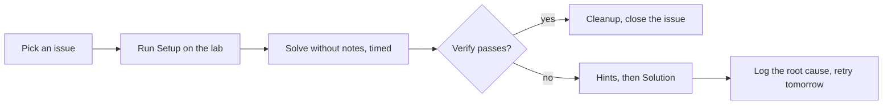

# CKA 14-Day Sprint

**Exam:** Fri 2026-11-13 · **Sprint:** Fri 2026-10-30 → Thu 2026-11-12 · **Budget:** 2–3 focused hours/day

The first week builds the control-plane skills that managed Kubernetes (EKS) hides. The second week covers networking, storage and troubleshooting, then two timed mock exams.

## How to use this repo

- Each day is a **story** in [`stories/`](stories/). It has a user story, tasks, and timed acceptance criteria.
- A story is **done** only when every acceptance criterion passes **without notes**. The only allowed reference is kubernetes.io/docs, as in the exam.
- Tick checkboxes as you go and commit at the end of each day: `git commit -am "day-03: done"`.
- If a story isn't done, carry the failed criteria into the next day's **Notes** section. Don't skip them.
- Quick-reference material lives in [`cheatsheets/`](cheatsheets/). Type the commands; never paste them.

## Board

| Day | Date | Domain | Story | Status |
|---|---|---|---|---|
| 1 | Fri Oct 30 | Setup | [Lab cluster and speed setup](stories/day-01-lab-setup.md) | ☐ |
| 2 | Sat Oct 31 | Cluster architecture | [kubeadm internals and etcd backup/restore](stories/day-02-etcd-static-pods.md) | ☐ |
| 3 | Sun Nov 1 | Cluster architecture | [kubeadm cluster upgrade](stories/day-03-kubeadm-upgrade.md) | ☐ |
| 4 | Mon Nov 2 | Cluster architecture | [RBAC and kubeconfig](stories/day-04-rbac.md) | ☐ |
| 5 | Tue Nov 3 | Cluster architecture | [Helm, Kustomize, CRDs and operators](stories/day-05-helm-kustomize-crds.md) | ☐ |
| 6 | Wed Nov 4 | Workloads | [Deployments, config and resources](stories/day-06-workloads.md) | ☐ |
| 7 | Thu Nov 5 | Scheduling | [Scheduling and mini mock](stories/day-07-scheduling.md) | ☐ |
| 8 | Fri Nov 6 | Networking | [Services and DNS](stories/day-08-services-dns.md) | ☐ |
| 9 | Sat Nov 7 | Networking | [NetworkPolicy, Ingress, Gateway API, CNI](stories/day-09-netpol-ingress-gateway.md) | ☐ |
| 10 | Sun Nov 8 | Storage | [PV, PVC and StorageClass](stories/day-10-storage.md) | ☐ |
| 11 | Mon Nov 9 | Troubleshooting | [Break and fix the cluster](stories/day-11-troubleshoot-cluster.md) | ☐ |
| 12 | Tue Nov 10 | Mock exam | [killer.sh session 1](stories/day-12-mock-1.md) | ☐ |
| 13 | Wed Nov 11 | Review | [Redo misses, drill weak domains](stories/day-13-review.md) | ☐ |
| 14 | Thu Nov 12 | Mock exam | [killer.sh session 2 and exam prep](stories/day-14-mock-2.md) | ☐ |

## Exam weights (Feb 2025 curriculum, still current)

| Domain | Weight | Days |
|---|---|---|
| Troubleshooting | 30% | 11, 12, 13, + every day |
| Cluster Architecture, Installation & Configuration | 25% | 2–5 |
| Services & Networking | 20% | 8–9 |
| Workloads & Scheduling | 15% | 6–7 |
| Storage | 10% | 10 |

On 2026-11-27 the [official CKA page](https://training.linuxfoundation.org/certification/certified-kubernetes-administrator-cka/) said the exam is based on **Kubernetes v1.37**, with the same five domains and weights. Confirm it again before you book.

## Extra lessons

Two curriculum lines had no lesson in the 14-day sprint. They are now covered:

- [E1: A highly available control plane with kubeadm](notes/extra-01-ha-control-plane.md)
- [E2: Extension interfaces (CRI, CNI, CSI)](notes/extra-02-extension-interfaces.md)

## Practice backlog

Hands-on practice tasks are GitHub issues labeled `type:practice`, one milestone per domain. See [practice/README.md](practice/README.md) for the full list and a suggested order, and [REVIEW.md](REVIEW.md) for the content review.

## Cheat sheets

- [Speed setup](cheatsheets/speed-setup.md): aliases, vim, per-question habits
- [etcd backup and restore](cheatsheets/etcd.md)
- [kubeadm upgrade](cheatsheets/kubeadm-upgrade.md)
- [Troubleshooting playbook](cheatsheets/troubleshooting.md)
- [Exam-day checklist](cheatsheets/exam-day.md)
- [Offline prep](cheatsheets/offline-prep.md): downloads and image pre-pulls before going offline
- [Mac lab runbook, Days 1–11](labs/mac-runbook.md): every hands-on step in order, Apple Silicon + Multipass
- [Day 1 lab with Lima](labs/day-01-lima.md): build the cluster on a Mac with Lima, step by step
