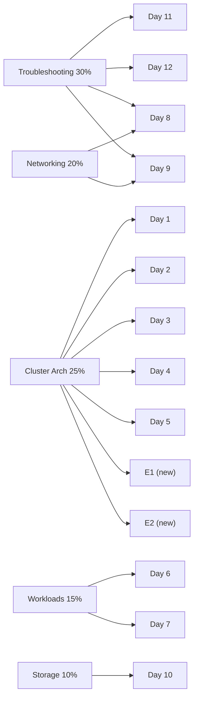

# Content review (2026-11-27)

This review checks every file in the repo against the current CKA curriculum and the `cp1` + `worker1` kubeadm + Calico lab. It lists the gaps, the errors, and the changes on branch `review/content-update`.

**Reference:** the [official CKA page](https://training.linuxfoundation.org/certification/certified-kubernetes-administrator-cka/) on 2026-11-27 says *"The exam is based on Kubernetes v1.37."* The five domains, their weights and their competency lines are the same as in the Feb 2025 curriculum that the README names. The [CNCF curriculum repo](https://github.com/cncf/curriculum) has `CKA_Curriculum_v1.37.pdf`.

**Overall:** the 14 lessons are accurate, deep and practical. Each has a "how it works" diagram, exam commands, traps and a self-check. The problems were few: two curriculum lines with no lesson, a version statement that went out of date, and about ten small errors in commands or examples.

---

## 1. Coverage matrix

| Domain | Competency (official wording) | Lessons | Gap before this review |
|---|---|---|---|
| **Troubleshooting (30%)** | Troubleshoot clusters and nodes | 1, 11 | — |
| | Troubleshoot cluster components | 2, 11 | — |
| | Monitor cluster and application resource usage | 6 (§6), 11 (§2, §5) | — |
| | Manage and evaluate container output streams | 11, 12 (§7) | Thin: only `--previous`. Practice issues add multi-container and label-based logs |
| | Troubleshoot services and networking | 8 (§6), 9, 12 | — |
| **Cluster Architecture (25%)** | Manage role based access control (RBAC) | 4 | — |
| | Prepare underlying infrastructure for installing a Kubernetes cluster | 1 (§3, §4) | — |
| | Create and manage Kubernetes clusters using kubeadm | 1, 2 | — |
| | Manage the lifecycle of Kubernetes clusters | 2, 3 | Lab is now 2 minors below the exam (see §3) |
| | **Implement and configure a highly-available control plane** | **none** | **Missing.** Added [E1](notes/extra-01-ha-control-plane.md) |
| | Use Helm and Kustomize to install cluster components | 5 | — |
| | **Understand extension interfaces (CNI, CSI, CRI, etc.)** | 1, 9 (§6), 10, 11 (scattered) | **No single lesson; CSI objects not covered.** Added [E2](notes/extra-02-extension-interfaces.md) |
| | Understand CRDs, install and configure operators | 5 | — |
| **Services & Networking (20%)** | Understand connectivity between Pods | 1, 9 | — |
| | Define and enforce Network Policies | 9 | — |
| | Use ClusterIP, NodePort, LoadBalancer service types and endpoints | 8 | — |
| | Use the Gateway API to manage Ingress traffic | 9 | — |
| | Know how to use Ingress controllers and Ingress resources | 9 | — |
| | Understand and use CoreDNS | 8 | — |
| **Workloads & Scheduling (15%)** | Rolling updates and rollbacks | 6 | — |
| | ConfigMaps and Secrets | 6 | — |
| | Configure workload autoscaling | 6 | — |
| | Primitives for robust, self-healing deployments | 6, 7 | — |
| | Configure Pod admission and scheduling (limits, node affinity, etc.) | 6, 7 | — |
| **Storage (10%)** | Storage classes and dynamic volume provisioning | 10 | — |
| | Volume types, access modes and reclaim policies | 10 | — |
| | Persistent volumes and persistent volume claims | 10 | — |

---

## 2. Errors found and fixed

| # | File | Problem | Fix |
|---|---|---|---|
| 1 | `notes/day-01-…` | Said the exam is v1.35. It is v1.37. | Updated the version text; explained the two upgrades the lab needs to match |
| 2 | `notes/day-01-…` | No warning that `192.168.0.0/16` overlaps the Mac VM network (the lab runbooks use `10.244.0.0/16`) | Added a comment at `kubeadm init`, plus a pointer to `--control-plane-endpoint` for HA |
| 3 | `notes/day-08-…` | Said `k get ep` is the short name for EndpointSlices. `ep` is the short name for **Endpoints**; EndpointSlice has none | Corrected the version note |
| 4 | `notes/day-12-…` | `k create ingress … --rule="web.example.com/=web:80"` makes an **Exact** path `/`, so `/anything` gets a 404 | Changed to `/*` (Prefix), as Day 9 teaches |
| 5 | `cheatsheets/speed-setup.md` | Same `/=` Exact-path example, and no `--class` | Changed to `--class=nginx --rule="…/*=web:80"` |
| 6 | `cheatsheets/speed-setup.md`, `cheatsheets/exam-day.md`, `stories/day-12-mock-1.md` | Said to set aliases once "in the first 2 minutes" and run `use-context` per question. The current exam is one `ssh` host per task, with `k` already set; Day 12 says so | Rewrote to the per-host loop: `ssh`, `hostname`, `export do=…` only where needed, `exit` |
| 7 | `cheatsheets/exam-day.md` | "Book the slot for Fri Nov 13 (today …)" | Made it date-free |
| 8 | `notes/day-05-…`, `notes/day-07-…` (mini mock task 4), `notes/day-13-…` (drill 1) | Used `bitnami/nginx`. Bitnami stopped publishing free images in Aug 2025, so these charts often end in `ImagePullBackOff` | Replaced with `podinfo/podinfo` (Day 5 already uses it); added a note in Day 5 |
| 9 | `notes/day-02-…` | `cp /etc/kubernetes/admin.conf ~/.kube/config` fails without root | `sudo cp … && sudo chown …` |
| 10 | `notes/day-06-…` | Link to `www.kubernetes.io` | `kubernetes.io` |

---

## 3. Lab notes (not changed in lessons, handled in practice issues)

- **Version skew.** The lab is v1.35 after Day 3. The exam is v1.37. kubeadm upgrades one minor at a time, so two more upgrades are needed. The upgrade issues in the backlog are written to be done twice (1.35 → 1.36 → 1.37).
- **containerd.** v1.35 is the last release that supports containerd 1.x. From v1.36 the kubelet falls back for containerd 1.y, and the [v1.36 container runtimes page](https://kubernetes.io/docs/setup/production-environment/container-runtimes/) says that fallback is removed in v1.38. Ubuntu's `containerd` package is 1.7. A practice issue moves both nodes to containerd 2.x before the upgrades.
- **Pod CIDR.** Lessons show `192.168.0.0/16`; the Mac labs use `10.244.0.0/16` and already say so. Practice issues tell you to read `podSubnet` from `kubeadm-config` instead of assuming either.
- **Stories still show the Oct 30 – Nov 12 sprint dates.** They are a record of the sprint, so they stay. The practice backlog is the way to keep drilling after it.

## 4. What was not changed, and why

- **Mermaid diagrams.** Every lesson already has at least one ASCII diagram in its "how it works" section. They render everywhere, including the offline terminal. Replacing them would not add information. The two new lessons, the README and this file use Mermaid.
- **Lessons that were correct and complete** were not rewritten, as requested.
- **Exam-speed tips** (`$do`, `kubectl explain`, imperative commands, context and host checks) are already in Days 1, 4, 12 and 14 and the speed-setup sheet. Only the per-host change in error 6 was needed.

## 5. Changes on this branch

| Commit topic | Files |
|---|---|
| Day 1 version and Mac CIDR note | `notes/day-01-architecture-and-kubeadm.md` |
| EndpointSlice short name and Ingress Prefix path | `notes/day-08-…`, `notes/day-12-…`, `cheatsheets/speed-setup.md` |
| Small command and link fixes | `notes/day-02-…`, `notes/day-06-…` |
| Replace Bitnami charts | `notes/day-05-…`, `notes/day-07-…`, `notes/day-13-…` |
| Per-host exam format | `cheatsheets/speed-setup.md`, `cheatsheets/exam-day.md`, `stories/day-12-mock-1.md` |
| New lesson E1: HA control plane | `notes/extra-01-ha-control-plane.md`, `notes/README.md` |
| New lesson E2: CRI, CNI, CSI | `notes/extra-02-extension-interfaces.md` |
| Practice backlog | `.github/ISSUE_TEMPLATE/practice-task.md`, `practice/ISSUES_PLAN.md`, `practice/README.md`, `README.md` |
| This report | `REVIEW.md` |
