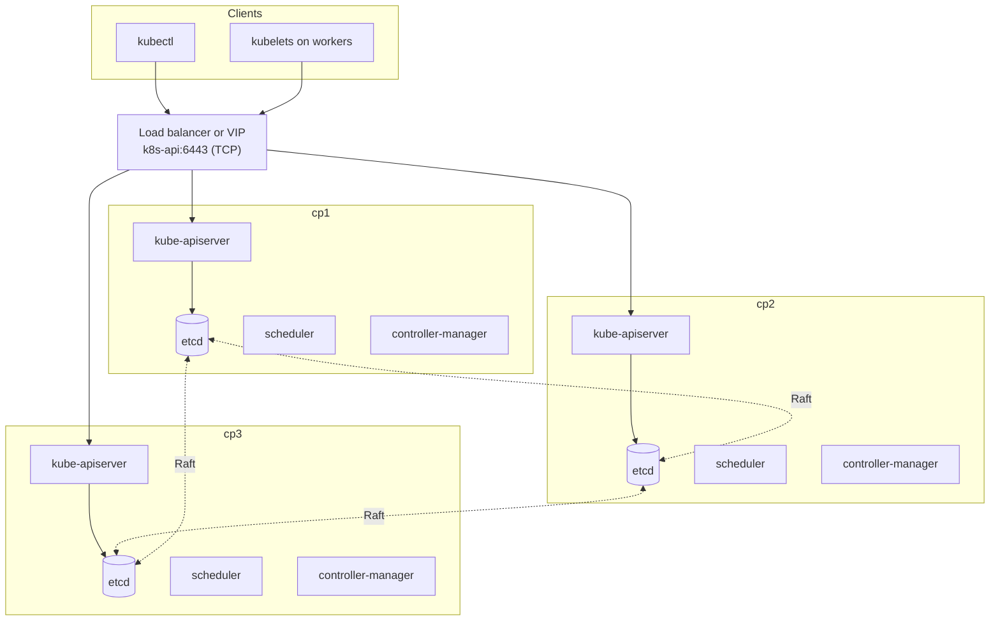

# Extra lesson 1: A highly available control plane with kubeadm

**Fills a gap:** the curriculum line *"Implement and configure a highly-available control plane"* (Cluster Architecture, Installation & Configuration, 25%). Days 1–14 used one control-plane node only. · **Read time:** ~25 min · **Then:** 1–2 hours in a separate 3-VM lab (optional, see section 5)

**Why this matters:** an exam task can ask you to join a second control-plane node, to give the join command for one, or to explain why a cluster needs 3 etcd members and not 2. The commands are short. The facts behind them (quorum, the certificate key, the shared endpoint) are what you must know.

On EKS, AWS runs the control plane on 3 AZs behind an NLB, and you never see it. Here you build the same thing: several API servers behind one address, and an etcd cluster that keeps quorum when one node fails.

> **Version note (checked 2026-11-27).** The exam is based on **Kubernetes v1.37** ([official CKA page](https://training.linuxfoundation.org/certification/certified-kubernetes-administrator-cka/)). The kubeadm HA procedure has not changed in recent releases. The two docs pages to bookmark are [Options for Highly Available Topology](https://kubernetes.io/docs/setup/production-environment/tools/kubeadm/ha-topology/) and [Creating Highly Available Clusters with kubeadm](https://kubernetes.io/docs/setup/production-environment/tools/kubeadm/high-availability/).

---

## 1. What "highly available" means for each component



| Component | How it runs in HA | What you check |
|---|---|---|
| **kube-apiserver** | **Active-active.** One per control-plane node. All serve at the same time behind the load balancer. | `k get pods -n kube-system -l component=kube-apiserver -o wide` |
| **etcd** | **Raft cluster.** One leader, the rest followers. A write needs a majority (quorum). | `etcdctl member list`, `etcdctl endpoint status --cluster` |
| **kube-scheduler**, **kube-controller-manager** | **Active-passive.** One per node, but only the leader works. They use leader election through a Lease object. | `k -n kube-system get lease kube-scheduler kube-controller-manager` (HOLDER column) |
| **Load balancer / VIP** | One stable address for the API (`--control-plane-endpoint`). It forwards TCP 6443 to every API server. | `k config view --minify \| grep server` shows the endpoint, not a node IP |

### etcd quorum: why 3 and not 2

Quorum = `floor(n/2) + 1` members must agree for a write.

| Members | Quorum | Failures it survives |
|---|---|---|
| 1 | 1 | 0 |
| 2 | 2 | **0** (worse than 1: two machines that can fail, no extra safety) |
| 3 | 2 | 1 |
| 5 | 3 | 2 |

Always use an **odd** number. If quorum is lost, etcd stops accepting writes, and the API server can't change anything. Reads may also fail.

---

## 2. The two topologies

| | **Stacked etcd** (kubeadm default) | **External etcd** |
|---|---|---|
| Where etcd runs | A static pod on each control-plane node | On separate hosts |
| Minimum hosts | 3 control-plane nodes | 3 control-plane + 3 etcd hosts |
| Risk | Losing one node loses one API server **and** one etcd member | etcd and the control plane fail separately |
| kubeadm setup | `kubeadm init --control-plane-endpoint ... --upload-certs` | A `ClusterConfiguration` with `etcd.external.endpoints` and the etcd client certs |

The exam and this lesson use **stacked etcd**. Know the external option by name and know its trade-off.

---

## 3. The commands

### 3a. Init the first control-plane node

```bash
sudo kubeadm init \
  --control-plane-endpoint "k8s-api:6443" \
  --upload-certs \
  --pod-network-cidr=10.244.0.0/16
```

- `--control-plane-endpoint` is the load balancer's DNS name (or VIP) and port. kubeadm puts it in the API server certificate SANs and in every kubeconfig. **Set it at init.** Adding it to a running single-node cluster means new API server certificates and new kubeconfigs. That is not an exam task.
- `--upload-certs` encrypts the shared control-plane certificates (cluster CA, etcd CA, front-proxy CA, service-account keys) and stores them in the Secret `kubeadm-certs` in `kube-system`. The output prints a **certificate key** that decrypts them.

The output prints two join commands. The control-plane one looks like this:

```bash
kubeadm join k8s-api:6443 --token <token> \
  --discovery-token-ca-cert-hash sha256:<hash> \
  --control-plane --certificate-key <key>
```

### 3b. Join another control-plane node

On cp2 (prerequisites from Day 1 done, packages at the **same** version as cp1):

```bash
sudo kubeadm join k8s-api:6443 --token <token> \
  --discovery-token-ca-cert-hash sha256:<hash> \
  --control-plane --certificate-key <key>
```

kubeadm downloads the shared certificates, creates this node's own leaf certificates, writes the four static pod manifests, and adds a new etcd member to the existing etcd cluster.

### 3c. The token or the certificate key expired

The bootstrap **token** is valid for 24 hours. The **certificate key** and the `kubeadm-certs` Secret are deleted after **2 hours**. To make new ones, on an existing control-plane node:

```bash
sudo kubeadm init phase upload-certs --upload-certs      # prints a new certificate key (last line)
sudo kubeadm token create --print-join-command           # prints a new worker join command
# control-plane join = that command + --control-plane --certificate-key <new key>

# or as one command:
sudo kubeadm token create --print-join-command \
  --certificate-key "$(sudo kubeadm init phase upload-certs --upload-certs | tail -1)"
```

### 3d. Check the HA cluster

```bash
k get nodes                                            # cp1, cp2, cp3 with role control-plane
k -n kube-system get pods -o wide | grep -E 'apiserver|etcd|scheduler|controller'
k -n kube-system get lease kube-scheduler kube-controller-manager   # HOLDER = the active one

sudo ETCDCTL_API=3 etcdctl --endpoints=https://127.0.0.1:2379 \
  --cacert=/etc/kubernetes/pki/etcd/ca.crt \
  --cert=/etc/kubernetes/pki/etcd/server.crt \
  --key=/etc/kubernetes/pki/etcd/server.key \
  member list -w table                                 # 3 members, all started
sudo ETCDCTL_API=3 etcdctl ... endpoint status --cluster -w table   # IS LEADER column
```

### 3e. Remove a control-plane node

```bash
k drain cp3 --ignore-daemonsets          # from a node where kubectl works
ssh cp3 sudo kubeadm reset -f            # removes the local etcd member, then cleans the node
k delete node cp3
```

If cp3 is dead and you can't run `kubeadm reset` on it, remove its etcd member by hand from a healthy node: `etcdctl member list` → `etcdctl member remove <ID>`. A dead member that stays in the list still counts toward quorum size.

### 3f. Upgrades in HA

Day 3 already has the rule: `kubeadm upgrade apply` **once**, on the first control-plane node. On every other control-plane node, run `kubeadm upgrade node` (it upgrades that node's static pods and etcd member), then its kubelet. One node at a time.

---

## 4. The load balancer

kubeadm does not create the load balancer. You give it one. The usual options:

| Option | How it works |
|---|---|
| Cloud LB (NLB on AWS) | TCP listener on 6443, target group = the control-plane nodes |
| **HAProxy** (+ keepalived for a floating VIP) | A TCP proxy on a separate VM, or on every control-plane node with keepalived |
| **kube-vip** | A static pod on each control-plane node that holds a virtual IP (ARP or BGP). Follow the kube-vip docs for the kubeadm specifics. |
| DNS name in `/etc/hosts` | **Lab only.** No failover, but you can practise every kubeadm step and add a real LB later without changing certificates |

A minimal HAProxy config (TCP passthrough, TLS ends at the API servers):

```
frontend k8s-api
    bind *:6443
    mode tcp
    default_backend control-plane
backend control-plane
    mode tcp
    option tcp-check
    balance roundrobin
    server cp1 192.168.64.11:6443 check
    server cp2 192.168.64.12:6443 check
    server cp3 192.168.64.13:6443 check
```

---

## 5. Hands-on (optional): a 3-node control plane in a separate lab

Your `cp1` + `worker1` lab was built without `--control-plane-endpoint`, so keep it as it is. Build a **second, throw-away** lab for this lesson. Each VM needs at least 2 vCPU and 2 GB RAM (kubeadm preflight needs 2 CPUs and about 1.7 GB).

**Step 1: three VMs.** Use the same tool as your Day 1 lab (Multipass or Lima): `ha-cp1`, `ha-cp2`, `ha-cp3`. Do the Day 1 node prerequisites and package install on all three, at the **same** Kubernetes version.

**Step 2: the endpoint.** On all three VMs, add `k8s-api` to `/etc/hosts`, pointing at ha-cp1's IP:

```bash
echo "<ha-cp1-ip> k8s-api" | sudo tee -a /etc/hosts
```

(For real failover, put HAProxy on a fourth small VM, point `k8s-api` at it, and use the config in section 4.)

**Step 3: init and CNI on ha-cp1.** Section 3a, then the Calico steps from your Day 1 lab.

**Step 4: join ha-cp2 and ha-cp3.** ⏱ Target **< 5 min each**, from the saved join command.

**Step 5: check.** Section 3d. Write down which node holds each Lease and which etcd member is leader.

**Step 6: break it.** Stop etcd on ha-cp3: `sudo mv /etc/kubernetes/manifests/etcd.yaml /tmp/` on ha-cp3. From ha-cp1, `k create ns q1` still works: 2 of 3 etcd members are a quorum. Then do the same on ha-cp2. Now `k create ns q2` fails or hangs: 1 of 3 is not a quorum. (In stacked etcd each API server talks only to its local etcd member at `127.0.0.1:2379`, so ha-cp1's API server is still running but can't write.) Put both files back and watch the cluster recover.

**Step 7: expired key.** Wait more than 2 hours (or delete the `kubeadm-certs` Secret), then make a fresh control-plane join command with section 3c.

**Cleanup:** delete the three VMs. Your main lab is unchanged.

---

## 6. Traps that cost points

- **Two control-plane nodes "for HA".** Two etcd members survive **zero** failures. Use 3.
- **Forgetting `--upload-certs`** at init. Then the join needs the certificates copied by hand, or a later `kubeadm init phase upload-certs --upload-certs`.
- **Using a worker join command** for a control-plane node. Without `--control-plane --certificate-key`, the node joins as a worker.
- **Expired certificate key.** It lives for 2 hours. Make a new one with `kubeadm init phase upload-certs --upload-certs`.
- **Different versions** on the joining node. Install the same kubeadm/kubelet version as the cluster.
- **Endpoint = a node IP.** If `--control-plane-endpoint` is cp1's IP, the cluster is not HA, because every client depends on cp1. Use a DNS name or a VIP.
- **Thinking the schedulers all work at once.** Only the Lease holder schedules. The others wait.
- **Deleting a dead control-plane node without removing its etcd member.** The member list still has 3 entries, so one more failure loses quorum.

---

## 7. Self-check

1. A cluster has 3 stacked control-plane nodes. Two fail. Can you still create a Deployment? Why or why not?
2. Why is a 2-member etcd cluster less available than a 1-member cluster?
3. Which kubeadm flag stores the shared certificates in the cluster, and for how long are they kept?
4. You must join cp4 as a control-plane node 3 hours after `kubeadm init`. Which two commands do you run first, and on which node?
5. Which control-plane components run active-active, and which run active-passive? How do you see which scheduler is active?
6. What is the difference between stacked and external etcd? Give one benefit of each.
7. Why must you set `--control-plane-endpoint` at init, and what value should it have?

<details>
<summary>Answers</summary>

1. No. 1 of 3 etcd members is not a quorum (2 needed), so etcd refuses writes and the API server can't store the Deployment.
2. With 2 members, quorum is 2, so the failure of **either** member stops writes. You doubled the machines that can fail and gained no tolerance.
3. `--upload-certs` (at init, or later with `kubeadm init phase upload-certs --upload-certs`). The Secret `kubeadm-certs` and its certificate key are deleted after 2 hours.
4. On an existing control-plane node: `sudo kubeadm init phase upload-certs --upload-certs` (new certificate key) and `sudo kubeadm token create --print-join-command` (new token). Then run the join on cp4 with `--control-plane --certificate-key <new key>`.
5. kube-apiserver is active-active (and etcd is a Raft cluster with one leader). kube-scheduler and kube-controller-manager are active-passive through leader election. `k -n kube-system get lease kube-scheduler` shows the HOLDER.
6. Stacked: etcd runs on the control-plane nodes; fewer machines and simpler setup. External: etcd runs on its own hosts; a control-plane node failure doesn't remove an etcd member, so failures are independent.
7. kubeadm writes it into the API server certificate SANs and every kubeconfig. Changing it later means new certificates and kubeconfigs. Use a DNS name or a VIP of a load balancer in front of all API servers, not one node's IP.

</details>

---

**Done when:** you can say the quorum table from memory, write the control-plane join command and the two "expired key" commands without notes, and (if you built the lab) you joined two control-plane nodes in under 5 minutes each. Practice issues for this lesson are labeled `domain:cluster-arch` in the [practice backlog](../practice/README.md).
