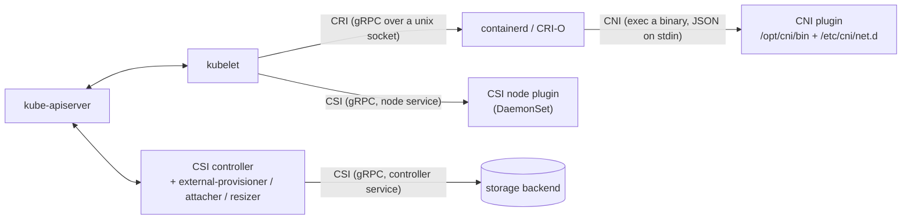

# Extra lesson 2: Extension interfaces (CRI, CNI, CSI)

**Fills a gap:** the curriculum line *"Understand extension interfaces (CNI, CSI, CRI, etc.)"* (Cluster Architecture, Installation & Configuration, 25%). Days 1, 9, 10 and 11 touch each interface, but no lesson puts them side by side. · **Read time:** ~20 min · **Then:** 45 min in the lab

**Why this matters:** the exam can ask "which container runtime does node X use, and on which socket", "which CNI is installed and where is its config", or "which CSI drivers does this cluster have". Each is a 2-minute task if you know where to look. The same knowledge is the base for Troubleshooting (30%): a wrong CRI socket or an empty `/etc/cni/net.d/` makes a node `NotReady`.

On EKS, AWS chose all three for you: containerd, the VPC CNI, and the EBS CSI driver as an add-on. Here they are separate, swappable plugins, and each has its own files and objects.

> **Version note (checked 2026-11-27).** The exam is based on **Kubernetes v1.37**. The kubelet talks only to CRI runtimes (dockershim was removed in v1.24). In-tree cloud volume plugins have been migrated to CSI drivers. Other extension points exist, such as device plugins and Dynamic Resource Allocation (`resource.k8s.io`), but the curriculum names CRI, CNI and CSI.

---

## 1. Who calls whom



| Interface | Who calls it | What it does | Transport |
|---|---|---|---|
| **CRI** (Container Runtime Interface) | kubelet | Pull images, create pod sandboxes, start/stop containers, read logs | gRPC over a unix socket |
| **CNI** (Container Network Interface) | The **runtime** (containerd's CRI plugin), when it creates a pod sandbox | Create the pod's network interface, give it an IP, set routes | Runs a binary from `/opt/cni/bin/` with a config from `/etc/cni/net.d/` |
| **CSI** (Container Storage Interface) | kubelet (node side) and sidecar controllers (cluster side) | Create, attach, mount, resize and snapshot volumes | gRPC over unix sockets |

Note the CNI line: the kubelet does **not** run the CNI plugin itself. It asks the runtime for a sandbox, and the runtime runs CNI.

---

## 2. CRI: the container runtime

| What | Where |
|---|---|
| containerd socket | `unix:///run/containerd/containerd.sock` |
| CRI-O socket | `unix:///var/run/crio/crio.sock` |
| kubelet setting | `containerRuntimeEndpoint` in `/var/lib/kubelet/config.yaml`, or `--container-runtime-endpoint` in `/var/lib/kubelet/kubeadm-flags.env`. Check both |
| crictl setting | `/etc/crictl.yaml` (`runtime-endpoint`) |
| Runtime config | `/etc/containerd/config.toml` (cgroup driver, CNI dirs, registry mirrors) |
| Runtime version per node | `k get nodes -o wide` → `CONTAINER-RUNTIME` column |

```bash
k get nodes -o wide                                                  # containerd://2.x.y or 1.7.x
k get node worker1 -o jsonpath='{.status.nodeInfo.containerRuntimeVersion}{"\n"}'
ssh worker1
sudo grep -i containerRuntimeEndpoint /var/lib/kubelet/config.yaml
sudo cat /var/lib/kubelet/kubeadm-flags.env
sudo crictl info | head -20                                          # runtime status, CNI config it loaded
exit
```

**RuntimeClass** (`node.k8s.io/v1`) lets a pod choose a runtime handler (for example gVisor or Kata) with `spec.runtimeClassName`. The handler must exist in the runtime's config. Know the object by name.

---

## 3. CNI: the pod network

Day 9, section 6 has the details. The short version:

| What | Where |
|---|---|
| Network config | `/etc/cni/net.d/` (the runtime uses the first file in sort order, for example `10-calico.conflist`) |
| Plugin binaries | `/opt/cni/bin/` |
| Pod CIDR | `k -n kube-system get cm kubeadm-config -o yaml \| grep podSubnet` |
| Installed CNI | The DaemonSet in `kube-system`, `calico-system`, `kube-flannel` or similar |

```bash
ls /etc/cni/net.d/ /opt/cni/bin/
sudo cat /etc/cni/net.d/*.conflist | grep -E '"type"|"name"'
k get ds -A | grep -iE 'calico|cilium|flannel|weave|antrea'
```

Not every CNI enforces NetworkPolicy. Calico, Cilium and Antrea do. Flannel does not.

---

## 4. CSI: storage drivers

A CSI driver has two parts:

- A **controller** (Deployment or StatefulSet) with Kubernetes sidecars: `external-provisioner` (creates volumes for PVCs), `external-attacher` (VolumeAttachment objects), `external-resizer` (PVC expansion) and `external-snapshotter` (VolumeSnapshots).
- A **node plugin** (DaemonSet) with `node-driver-registrar`, which registers the driver's socket with the kubelet under `/var/lib/kubelet/plugins_registry/`. The kubelet then calls it to mount volumes.

The API objects:

| Object | Scope | Tells you |
|---|---|---|
| `CSIDriver` | Cluster | Which drivers are installed, and their options (attachRequired, podInfoOnMount, fsGroupPolicy) |
| `CSINode` | Cluster (one per node) | Which drivers are registered on that node |
| `VolumeAttachment` | Cluster | Which PV is attached to which node |
| `StorageClass.provisioner` | Cluster | The CSI driver name that provisions volumes for that class (`ebs.csi.aws.com`, `nfs.csi.k8s.io` …) |

```bash
k get csidrivers
k get csinodes
k get csinode worker1 -o jsonpath='{.spec.drivers[*].name}{"\n"}'
k get volumeattachments
k get sc -o custom-columns=NAME:.metadata.name,PROVISIONER:.provisioner
```

**Your lab:** `local-path-provisioner` (Day 10) is **not** a CSI driver. It's a plain controller that creates hostPath-style PVs. So `k get csidrivers` is empty in your lab, and that is a correct answer to "which CSI drivers are installed". To see a real CSI driver, install one in a test namespace, for example the [CSI hostpath driver](https://github.com/kubernetes-csi/csi-driver-host-path) (follow its README deploy steps) or the NFS CSI driver if you have an NFS server.

---

## 5. Hands-on walkthrough on cp1 + worker1

From cp1. Write each answer into `/opt/answers/ext-<n>.txt` (create the directory with `sudo mkdir -p /opt/answers && sudo chown $USER /opt/answers`). Exam tasks often ask for answers in a file.

1. The runtime and its version for each node: `k get nodes -o wide`. Write `<node> <runtime>` lines to `ext-1.txt`.
2. The CRI socket the kubelet on worker1 uses. Find it in the kubelet files, not from memory. Write it to `ext-2.txt`.
3. The CNI config file name on worker1 and the plugin `type` inside it. Write both to `ext-3.txt`.
4. The installed CSI drivers (`k get csidrivers`; "none" is a valid answer) and the provisioner of each StorageClass. Write them to `ext-4.txt`.
5. Optional break and fix (take a VM snapshot first): on worker1, back up `/var/lib/kubelet/kubeadm-flags.env` and `/var/lib/kubelet/config.yaml` to `/root/`, change the containerd socket path in the file where you found it in step 2 to `/run/containerd/containerd.sockx`, and restart the kubelet. Read `journalctl -u kubelet -n 30` and `k describe node worker1`. Restore the file and restart the kubelet.

---

## 6. Traps that cost points

- **Looking for the CNI config in the kubelet.** The runtime loads it. Check `/etc/cni/net.d/` and `crictl info`.
- **Confusing the CRI socket path.** containerd: `/run/containerd/containerd.sock`. CRI-O: `/var/run/crio/crio.sock`. Read the kubelet's own config before you answer.
- **Calling local-path a CSI driver.** It isn't, so `k get csidrivers` shows nothing for it.
- **Expecting NetworkPolicy to work with Flannel.** It doesn't enforce policies.
- **Changing the cgroup driver in one place only.** containerd (`SystemdCgroup = true`) and the kubelet (`cgroupDriver: systemd`) must agree (Day 1).

---

## 7. Self-check

1. Which component runs the CNI plugin when a pod starts: the kubelet or containerd?
2. Name two places where the kubelet's CRI endpoint can be set on a kubeadm node.
3. What do `CSIDriver` and `CSINode` objects tell you?
4. Which CSI sidecar handles PVC expansion, and which one creates volumes for new PVCs?
5. `k get csidrivers` returns nothing, but PVCs bind dynamically. How is that possible?
6. Where do you find the runtime version of every node with one command?

<details>
<summary>Answers</summary>

1. containerd (its CRI plugin), when it creates the pod sandbox. The kubelet only talks CRI to the runtime.
2. `containerRuntimeEndpoint` in `/var/lib/kubelet/config.yaml`, and `--container-runtime-endpoint` in `/var/lib/kubelet/kubeadm-flags.env`.
3. `CSIDriver`: which drivers are installed in the cluster and how Kubernetes should treat them. `CSINode`: which drivers are registered on each node.
4. `external-resizer` for expansion. `external-provisioner` for new volumes.
5. The provisioner is not a CSI driver, for example `rancher.io/local-path`. Dynamic provisioning works with any provisioner controller, not only CSI.
6. `k get nodes -o wide` (CONTAINER-RUNTIME column).

</details>

---

**Done when:** you answered the four lab questions into `/opt/answers/` in under 8 minutes total, without this page. Practice issues for this lesson are in the [practice backlog](../practice/README.md).
