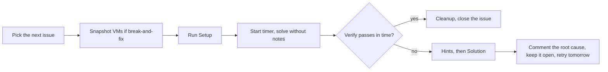

# Practice backlog

Hands-on practice tasks for the `cp1` + `worker1` lab, as GitHub issues. Each issue has an objective, an exam-style scenario, setup commands, acceptance criteria, verify commands, a time box, the related lesson, and hints and a solution in collapsed blocks. Break-and-fix issues break the lab on purpose: take a VM snapshot first.

- Filter on GitHub: [all practice issues](https://github.com/gvarun17/cka-study/issues?q=is%3Aissue+label%3Atype%3Apractice) · [break-and-fix](https://github.com/gvarun17/cka-study/issues?q=is%3Aissue+label%3Atype%3Abreak-fix) · [mocks](https://github.com/gvarun17/cka-study/issues?q=is%3Aissue+label%3Atype%3Amock) · [milestones (one per domain)](https://github.com/gvarun17/cka-study/milestones)
- The plan written before the issues were created: [ISSUES_PLAN.md](ISSUES_PLAN.md). New tasks: use the [practice task template](../.github/ISSUE_TEMPLATE/practice-task.md).

## How to use an issue

Close an issue only when you pass it inside its time box without hints. Reopen it a week later as a refresher.

## Suggested order

**Phase 1: bring the lab to the exam version (v1.37).** The lab is v1.35 after Day 3. v1.36+ no longer supports containerd 1.x, and kubeadm upgrades one minor at a time.

1. [#23](https://github.com/gvarun17/cka-study/issues/23) containerd 2.x on both nodes
2. [#9](https://github.com/gvarun17/cka-study/issues/9) then [#10](https://github.com/gvarun17/cka-study/issues/10): 1.35 → 1.36
3. The same two issues again: 1.36 → 1.37. Reopen them after the first pass.
4. [#8](https://github.com/gvarun17/cka-study/issues/8) drain flags and PDBs

**Phase 2: Troubleshooting first (30%).** Node faults, then control-plane faults, then applications and Services.

- Nodes: [#48](https://github.com/gvarun17/cka-study/issues/48), [#49](https://github.com/gvarun17/cka-study/issues/49), [#50](https://github.com/gvarun17/cka-study/issues/50), [#51](https://github.com/gvarun17/cka-study/issues/51), [#52](https://github.com/gvarun17/cka-study/issues/52), [#22](https://github.com/gvarun17/cka-study/issues/22), [#3](https://github.com/gvarun17/cka-study/issues/3)
- Control plane: [#54](https://github.com/gvarun17/cka-study/issues/54), [#55](https://github.com/gvarun17/cka-study/issues/55), [#56](https://github.com/gvarun17/cka-study/issues/56), [#57](https://github.com/gvarun17/cka-study/issues/57), [#12](https://github.com/gvarun17/cka-study/issues/12)
- Applications and Services: [#58](https://github.com/gvarun17/cka-study/issues/58), [#59](https://github.com/gvarun17/cka-study/issues/59), [#60](https://github.com/gvarun17/cka-study/issues/60), [#61](https://github.com/gvarun17/cka-study/issues/61), [#53](https://github.com/gvarun17/cka-study/issues/53), [#37](https://github.com/gvarun17/cka-study/issues/37), [#38](https://github.com/gvarun17/cka-study/issues/38), [#28](https://github.com/gvarun17/cka-study/issues/28), [#30](https://github.com/gvarun17/cka-study/issues/30)

**Phase 3: Cluster Architecture (25%).** The high-value control-plane tasks first: [#4](https://github.com/gvarun17/cka-study/issues/4), [#7](https://github.com/gvarun17/cka-study/issues/7), then RBAC, Helm, Kustomize and CRDs, then the HA and extension-interface lessons.

**Phase 4: Services & Networking (20%), Workloads & Scheduling (15%), Storage (10%).** In table order below.

**Phase 5: timed mocks.** [#62](https://github.com/gvarun17/cka-study/issues/62), [#63](https://github.com/gvarun17/cka-study/issues/63), [#64](https://github.com/gvarun17/cka-study/issues/64). Do Mock C last, as a full 2-hour run. Repeat it until you finish with 30 minutes left.

## All issues

### Day 1: How a cluster works, and kubeadm

Lesson: [notes/day-01-architecture-and-kubeadm.md](../notes/day-01-architecture-and-kubeadm.md)

| # | Task | Domain | Difficulty | Time box (min) | Break-and-fix |
|---|---|---|---|---|---|
| [#1](https://github.com/gvarun17/cka-study/issues/1) | Map every control-plane file to the kubeadm phase that made it | Cluster Arch | easy | 8 |  |
| [#2](https://github.com/gvarun17/cka-study/issues/2) | Remove worker1 and join it again with a new token | Cluster Arch | medium | 12 |  |
| [#3](https://github.com/gvarun17/cka-study/issues/3) | kubeadm join fails preflight on worker1 | Troubleshooting | medium | 10 | yes |

### Day 2: static pods, certificates, etcd

Lesson: [notes/day-02-etcd-and-static-pods.md](../notes/day-02-etcd-and-static-pods.md)

| # | Task | Domain | Difficulty | Time box (min) | Break-and-fix |
|---|---|---|---|---|---|
| [#4](https://github.com/gvarun17/cka-study/issues/4) | Take an etcd snapshot and record its status | Cluster Arch | easy | 4 |  |
| [#5](https://github.com/gvarun17/cka-study/issues/5) | Create a static pod on worker1 with a non-default manifest path | Cluster Arch | medium | 8 |  |
| [#6](https://github.com/gvarun17/cka-study/issues/6) | Check certificate expiry and renew only the API server certificate | Cluster Arch | medium | 8 |  |
| [#7](https://github.com/gvarun17/cka-study/issues/7) | Restore etcd from a snapshot and prove the state went back | Cluster Arch | hard | 10 |  |

### Day 3: kubeadm upgrade

Lesson: [notes/day-03-kubeadm-upgrade.md](../notes/day-03-kubeadm-upgrade.md)

| # | Task | Domain | Difficulty | Time box (min) | Break-and-fix |
|---|---|---|---|---|---|
| [#8](https://github.com/gvarun17/cka-study/issues/8) | Drain a node that has every kind of drain blocker | Cluster Arch | medium | 8 |  |
| [#9](https://github.com/gvarun17/cka-study/issues/9) | Upgrade the control plane by one minor version | Cluster Arch | hard | 15 |  |
| [#10](https://github.com/gvarun17/cka-study/issues/10) | Upgrade worker1 to match the control plane | Cluster Arch | hard | 10 |  |

### Day 4: RBAC and kubeconfig

Lesson: [notes/day-04-rbac-and-kubeconfig.md](../notes/day-04-rbac-and-kubeconfig.md)

| # | Task | Domain | Difficulty | Time box (min) | Break-and-fix |
|---|---|---|---|---|---|
| [#11](https://github.com/gvarun17/cka-study/issues/11) | ServiceAccount that can only read pods and their logs in one namespace | Cluster Arch | easy | 3 |  |
| [#12](https://github.com/gvarun17/cka-study/issues/12) | kubectl fails with a broken kubeconfig | Troubleshooting | easy | 5 | yes |
| [#13](https://github.com/gvarun17/cka-study/issues/13) | Reuse one ClusterRole in two namespaces, and cluster-wide for nodes | Cluster Arch | medium | 6 |  |
| [#14](https://github.com/gvarun17/cka-study/issues/14) | Create user dana with the CSR API and a kubeconfig file for her | Cluster Arch | hard | 10 |  |

### Day 5: Helm, Kustomize, CRDs

Lesson: [notes/day-05-helm-kustomize-crds.md](../notes/day-05-helm-kustomize-crds.md)

| # | Task | Domain | Difficulty | Time box (min) | Break-and-fix |
|---|---|---|---|---|---|
| [#15](https://github.com/gvarun17/cka-study/issues/15) | Install, upgrade and roll back a Helm release | Cluster Arch | easy | 5 |  |
| [#16](https://github.com/gvarun17/cka-study/issues/16) | Build a Kustomize overlay that changes image, replicas and a label | Cluster Arch | medium | 6 |  |
| [#17](https://github.com/gvarun17/cka-study/issues/17) | Install a CRD and create a valid custom resource using only kubectl explain | Cluster Arch | medium | 6 |  |

### Extra 1: HA control plane

Lesson: [notes/extra-01-ha-control-plane.md](../notes/extra-01-ha-control-plane.md)

| # | Task | Domain | Difficulty | Time box (min) | Break-and-fix |
|---|---|---|---|---|---|
| [#18](https://github.com/gvarun17/cka-study/issues/18) | Explain quorum and inspect the etcd members and leaders | Cluster Arch | medium | 6 |  |
| [#19](https://github.com/gvarun17/cka-study/issues/19) | Make a fresh control-plane join command after the certificate key expired | Cluster Arch | medium | 6 |  |
| [#20](https://github.com/gvarun17/cka-study/issues/20) | Build a 3-node HA control plane in a separate lab | Cluster Arch | hard | 25 |  |

### Extra 2: CRI, CNI, CSI

Lesson: [notes/extra-02-extension-interfaces.md](../notes/extra-02-extension-interfaces.md)

| # | Task | Domain | Difficulty | Time box (min) | Break-and-fix |
|---|---|---|---|---|---|
| [#21](https://github.com/gvarun17/cka-study/issues/21) | Report the runtime, CRI socket, CNI and CSI drivers of the cluster | Cluster Arch | easy | 8 |  |
| [#22](https://github.com/gvarun17/cka-study/issues/22) | kubelet on worker1 can't talk to the container runtime | Troubleshooting | medium | 6 | yes |
| [#23](https://github.com/gvarun17/cka-study/issues/23) | Move both nodes from containerd 1.7 to containerd 2.x | Cluster Arch | hard | 30 |  |

### Day 6: workloads, config, resources

Lesson: [notes/day-06-workloads-config-resources.md](../notes/day-06-workloads-config-resources.md)

| # | Task | Domain | Difficulty | Time box (min) | Break-and-fix |
|---|---|---|---|---|---|
| [#24](https://github.com/gvarun17/cka-study/issues/24) | Roll out a bad image and roll back to a named revision | Workloads | easy | 3 |  |
| [#25](https://github.com/gvarun17/cka-study/issues/25) | Configure a pod from a ConfigMap key and a Secret volume | Workloads | easy | 5 |  |
| [#26](https://github.com/gvarun17/cka-study/issues/26) | Autoscale a Deployment on CPU and make the HPA report a value | Workloads | medium | 6 |  |
| [#27](https://github.com/gvarun17/cka-study/issues/27) | Job with parallelism and a CronJob in a fixed time zone | Workloads | medium | 6 |  |
| [#28](https://github.com/gvarun17/cka-study/issues/28) | Deployment shows 1/4 ready and no pods are Pending | Troubleshooting | medium | 5 | yes |

### Day 7: scheduling and multi-container pods

Lesson: [notes/day-07-scheduling.md](../notes/day-07-scheduling.md)

| # | Task | Domain | Difficulty | Time box (min) | Break-and-fix |
|---|---|---|---|---|---|
| [#29](https://github.com/gvarun17/cka-study/issues/29) | Add a native sidecar that ships the app's log file | Workloads | easy | 5 |  |
| [#30](https://github.com/gvarun17/cka-study/issues/30) | Three pods are Pending: name each reason from the events | Troubleshooting | easy | 5 | yes |
| [#31](https://github.com/gvarun17/cka-study/issues/31) | Run a monitoring pod on the control-plane node only | Workloads | medium | 5 |  |
| [#32](https://github.com/gvarun17/cka-study/issues/32) | Spread replicas with topology spread constraints | Workloads | medium | 5 |  |
| [#33](https://github.com/gvarun17/cka-study/issues/33) | Make room for a critical pod with PriorityClass preemption | Workloads | hard | 8 |  |

### Day 8: Services and DNS

Lesson: [notes/day-08-services-and-dns.md](../notes/day-08-services-and-dns.md)

| # | Task | Domain | Difficulty | Time box (min) | Break-and-fix |
|---|---|---|---|---|---|
| [#34](https://github.com/gvarun17/cka-study/issues/34) | Expose a Deployment on a fixed NodePort | Networking | easy | 3 |  |
| [#35](https://github.com/gvarun17/cka-study/issues/35) | Resolve Service, headless and pod names across namespaces | Networking | medium | 6 |  |
| [#36](https://github.com/gvarun17/cka-study/issues/36) | Add a static host entry and a stub domain to CoreDNS | Networking | medium | 6 |  |
| [#37](https://github.com/gvarun17/cka-study/issues/37) | Frontend can't reach the backend Service | Troubleshooting | medium | 5 | yes |
| [#38](https://github.com/gvarun17/cka-study/issues/38) | Cluster DNS is broken for every pod | Troubleshooting | hard | 8 | yes |

### Day 9: NetworkPolicy, Ingress, Gateway API, CNI

Lesson: [notes/day-09-netpol-ingress-gateway-cni.md](../notes/day-09-netpol-ingress-gateway-cni.md)

| # | Task | Domain | Difficulty | Time box (min) | Break-and-fix |
|---|---|---|---|---|---|
| [#39](https://github.com/gvarun17/cka-study/issues/39) | Only api pods from the frontend namespace may reach the db | Networking | medium | 6 |  |
| [#40](https://github.com/gvarun17/cka-study/issues/40) | Default-deny a namespace, then allow DNS and one egress path | Networking | medium | 6 |  |
| [#41](https://github.com/gvarun17/cka-study/issues/41) | Route two hosts and a path with one Ingress | Networking | medium | 6 |  |
| [#42](https://github.com/gvarun17/cka-study/issues/42) | Migrate an Ingress to a Gateway and HTTPRoute | Networking | medium | 7 |  |
| [#43](https://github.com/gvarun17/cka-study/issues/43) | Canary with Gateway API: 90/10 split plus a header override | Networking | hard | 8 |  |

### Day 10: storage

Lesson: [notes/day-10-storage.md](../notes/day-10-storage.md)

| # | Task | Domain | Difficulty | Time box (min) | Break-and-fix |
|---|---|---|---|---|---|
| [#44](https://github.com/gvarun17/cka-study/issues/44) | Static PV, PVC and a pod that writes to it | Storage | easy | 6 |  |
| [#45](https://github.com/gvarun17/cka-study/issues/45) | New default StorageClass with WaitForFirstConsumer and expansion | Storage | medium | 7 |  |
| [#46](https://github.com/gvarun17/cka-study/issues/46) | Three PVCs are Pending: find each mismatch | Storage | medium | 5 | yes |
| [#47](https://github.com/gvarun17/cka-study/issues/47) | Keep the data: protect a dynamic volume and reuse a Released PV | Storage | medium | 6 |  |

### Day 11: troubleshooting nodes

Lesson: [notes/day-11-troubleshoot-cluster.md](../notes/day-11-troubleshoot-cluster.md)

| # | Task | Domain | Difficulty | Time box (min) | Break-and-fix |
|---|---|---|---|---|---|
| [#48](https://github.com/gvarun17/cka-study/issues/48) | worker1 is NotReady (and must stay Ready after a reboot) | Troubleshooting | easy | 4 | yes |
| [#49](https://github.com/gvarun17/cka-study/issues/49) | kubelet on worker1 is in a restart loop | Troubleshooting | medium | 6 | yes |
| [#50](https://github.com/gvarun17/cka-study/issues/50) | worker1 NotReady while its pods still answer | Troubleshooting | medium | 6 | yes |
| [#51](https://github.com/gvarun17/cka-study/issues/51) | kubelet runs on worker1 but the node stays NotReady | Troubleshooting | hard | 8 | yes |
| [#52](https://github.com/gvarun17/cka-study/issues/52) | worker1 says the network plugin is not ready | Troubleshooting | hard | 8 | yes |

### Day 11: troubleshooting the control plane

Lesson: [notes/day-11-troubleshoot-cluster.md](../notes/day-11-troubleshoot-cluster.md)

| # | Task | Domain | Difficulty | Time box (min) | Break-and-fix |
|---|---|---|---|---|---|
| [#53](https://github.com/gvarun17/cka-study/issues/53) | Report resource usage and save container logs to files | Troubleshooting | easy | 5 |  |
| [#54](https://github.com/gvarun17/cka-study/issues/54) | New pods stay Pending with no events at all | Troubleshooting | medium | 5 | yes |
| [#55](https://github.com/gvarun17/cka-study/issues/55) | Scaling a Deployment does nothing | Troubleshooting | medium | 6 | yes |
| [#56](https://github.com/gvarun17/cka-study/issues/56) | kubectl: connection refused (API server keeps exiting) | Troubleshooting | hard | 8 | yes |
| [#57](https://github.com/gvarun17/cka-study/issues/57) | API server is down and there is no container to read logs from | Troubleshooting | hard | 8 | yes |

### Day 12: application troubleshooting drills

Lesson: [notes/day-12-mock-1-strategy-and-pacing.md](../notes/day-12-mock-1-strategy-and-pacing.md)

| # | Task | Domain | Difficulty | Time box (min) | Break-and-fix |
|---|---|---|---|---|---|
| [#58](https://github.com/gvarun17/cka-study/issues/58) | App in CrashLoopBackOff because a config file is missing | Troubleshooting | easy | 4 | yes |
| [#59](https://github.com/gvarun17/cka-study/issues/59) | Two Deployments stuck in ImagePullBackOff | Troubleshooting | easy | 4 | yes |
| [#60](https://github.com/gvarun17/cka-study/issues/60) | Pod restarts every few seconds and never becomes Ready | Troubleshooting | medium | 5 | yes |
| [#61](https://github.com/gvarun17/cka-study/issues/61) | Read logs from a crashed container in a multi-container pod | Troubleshooting | medium | 5 |  |

### Mixed mocks

| # | Task | Domains | Linked tasks | Time box (min) |
|---|---|---|---|---|
| [#62](https://github.com/gvarun17/cka-study/issues/62) | Mock A: 60-minute mixed set (Days 2–7) | Cluster Arch, Workloads | 8 | 60 |
| [#63](https://github.com/gvarun17/cka-study/issues/63) | Mock B: 60-minute mixed set (Days 8–12) | Networking, Storage, Troubleshooting | 8 | 60 |
| [#64](https://github.com/gvarun17/cka-study/issues/64) | Mock C: 2-hour speed run weighted like the exam | Troubleshooting, Cluster Arch, Networking, Workloads, Storage | 16 | 120 |

## Totals

| Domain | Exam weight | Issues |
|---|---|---|
| Troubleshooting | 30% | 21 |
| Cluster Arch | 25% | 20 |
| Networking | 20% | 8 |
| Workloads | 15% | 8 |
| Storage | 10% | 4 |
| Mixed mocks | — | 3 |

**Total: 64 issues.**
